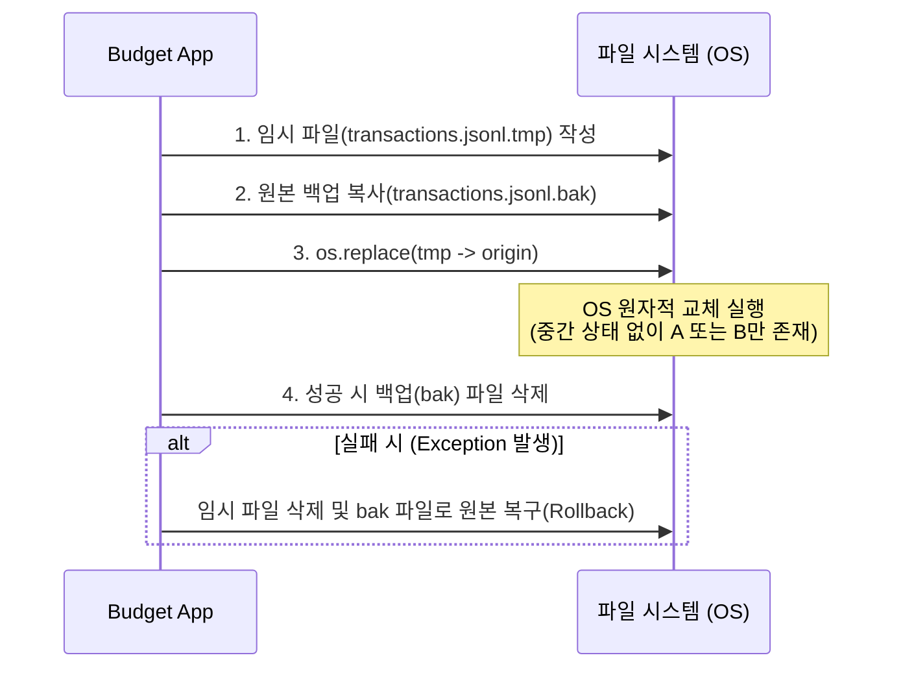

# 콘솔 가계부 프로젝트 심화 학습 가이드 (Study Guide)

본 문서는 **B2-1 과제(콘솔 가계부 budget_app)**를 바탕으로, 백엔드/소프트웨어 엔지니어링의 핵심 설계 원칙과 실무 기법을 학습할 수 있도록 구성한 종합 학습서입니다.

---

## 목차
1. [계층형 아키텍처와 관심사 분리 (Layered Architecture & SoC)](#1-계층형-아키텍처와-관심사-분리)
2. [데이터 저장소 설계: JSONL vs CSV vs RDBMS](#2-데이터-저장소-설계-jsonl-vs-csv-vs-rdbms)
3. [ACID와 원자적 파일 교체 (Atomic File Replacement & Rollback)](#3-acid와-원자적-파일-교체)
4. [Python 고급 문법: 제너레이터와 스트리밍 I/O](#4-python-고급-문법-제너레이터와-스트리밍-io)
5. [AOP와 데코레이터 패턴 (Cross-Cutting Concerns)](#5-aop와-데코레이터-패턴)
6. [방어적 프로그래밍과 데이터 무결성 보장](#6-방어적-프로그래밍과-데이터-무결성-보장)
7. [대용량 데이터(100k~1M+) 확장 전략 (Scalability)](#7-대용량-데이터100k1m-확장-전략)
8. [CLI 도구 설계와 POSIX 표준 프로세스 종료 코드](#8-cli-도구-설계와-posix-표준-프로세스-종료-코드)
9. [자가 점검 퀴즈 & 실전 과제](#9-자가-점검-퀴즈--실전-과제)

---

## 1. 계층형 아키텍처와 관심사 분리

### 핵심 개념
소프트웨어 규모가 커질수록 **"어떤 코드가 어디에 위치해야 하는가"**에 대한 명확한 규칙이 필요합니다.
`budget_app`은 전통적인 **3계층 아키텍처(3-Tier Architecture)** 모델을 콘솔 환경에 맞추어 변형 적용했습니다.

```mermaid
graph TD
    User([사용자 / 터미널]) --> CLI[CLI / Presentation 계층 (cli.py)]
    CLI --> Service[Service / Business 계층 (service.py)]
    Service --> Storage[Storage / Persistence 계층 (storage.py)]
    Service -.-> Model[Domain Model (models.py)]
    Storage -.-> Model
    CLI -.-> Decorator[Cross-Cutting / AOP (decorators.py)]
```

### 계층별 책임과 단방향 의존 원칙
1. **프레젠테이션 계층 (`cli.py`)**:
   - 오직 사용자와의 접점(CLI 인자 파싱, 대화형 프롬프트, 콘솔 출력 문자열 서식화)만 담당합니다.
   - 비즈니스 로직(예: 예산 초과 계산, 카테고리 참조 무결성 등)을 직접 구현하지 않고 서비스 계층에 위임합니다.
2. **서비스 계층 (`service.py`)**:
   - 시스템의 **비즈니스 규칙(도메인 로직)**을 캡슐화합니다.
   - 예: "금액은 양수여야 한다", "카테고리 삭제 시 사용처가 있으면 대체 카테고리가 필요하다", "예산 사용률 계산".
   - 저장소 계층을 주입받아 데이터의 영속화를 요청합니다.
3. **저장소 계층 (`storage.py`)**:
   - 데이터가 JSONL 파일에 어떻게 기록되고 읽히는지(File I/O, 디스크 원자성, 인코딩)만 담당합니다.
   - 상위 비즈니스 로직에 관여하지 않고 순수한 데이터 접근 인터페이스(CRUD)만 제공합니다.
4. **모델 계층 (`models.py`)**:
   - 데이터 구조를 정의하며(`dataclass Transaction`), 직렬화(`to_dict`) 및 역직렬화(`from_dict`) 책임을 가집니다.

> 💡 **학습 포인트**: 계층 간 의존 방향은 항상 **CLI -> Service -> Storage**의 단방향이어야 합니다. 하위 계층이 상위 계층을 참조하면 스파게티 코드가 됩니다.

---

## 2. 데이터 저장소 설계: JSONL vs CSV vs RDBMS

### 파일 포맷 비교
| 특성 | JSONL (JSON Lines) | CSV (Comma-Separated) | SQLite / RDBMS |
| :--- | :--- | :--- | :--- |
| **레코드 구조** | 행당 1개 JSON 객체 | 쉼표 구분 표 형식 | 테이블 & 컬럼 정의 |
| **추가 쓰기 (Append)** | 매우 빠름 ($O(1)$) | 빠름 ($O(1)$) | 트랜잭션 로그 기반 ($O(1)$) |
| **중첩 데이터/리스트** | 자연스럽게 지원 (`tags: [...]`) | 비표준 분리자 필요 (예: 콤마 중첩) | 1:N 관계 매핑 테이블 필요 |
| **파싱 복잡도** | 행 단위 독립 파싱 용이 | 콤마/따옴표/개행 이스케이프 주의 | SQL 파서 및 엔진 필요 |
| **파일 손상 내성** | 특정 줄이 깨져도 나머지 줄 파싱 가능 | 특정 줄의 쉼표/개행 깨짐 시 전체 손상 | 저널링으로 복구 지원 |
| **외부 호환성** | 로그 분석 도구 친화적 | 엑셀/스프레드시트 최적화 | 범용 데이터베이스 툴 |

### 본 프로젝트에서의 설계 철학
- **내부 DB 대용**: `JSONL`을 선택함으로써 별도의 DBMS 설치 없이도 파일 기반으로 복합 필드(리스트형 태그 등)를 안전하게 다루고, 한 줄씩 스트리밍 처리할 수 있는 구조를 구축했습니다.
- **외부 데이터 교환**: 다른 회계 프로그램이나 엑셀과의 연동을 위해 `CSV` export/import 기능을 함께 제공하여 상호운용성을 극대화했습니다.

---

## 3. ACID와 원자적 파일 교체

### 파일 쓰기의 본질적 위험
일반적으로 `open("file.txt", "w")`로 파일을 열고 중간에 쓰기 작업을 수행하다가 프로그램이 강제 종료되거나 전원이 꺼지면 **파일 크기가 0이 되거나 내용이 잘려 전체 데이터가 유실(Data Corruption)**됩니다.

### os.replace를 통한 원자성(Atomicity) 확보
현대 OS(Linux, macOS, Windows)는 파일 이름 변경 시스템 콜(`rename` / `replace`)을 **원자적(Atomic)**으로 처리합니다.



### 코드 분석 (`budget_app/storage.py`)
```python
def rewrite_all(self, transactions: List[Transaction]) -> None:
    tmp_path = self.path + ".tmp"
    bak_path = self.path + ".bak"
    try:
        # 1. 임시 파일에 쓰기
        with open(tmp_path, "w", encoding="utf-8") as f:
            for tx in transactions:
                f.write(json.dumps(tx.to_dict(), ensure_ascii=False) + "\n")
        # 2. 백업 생성 후 원자적 교체
        if os.path.exists(self.path):
            shutil.copy2(self.path, bak_path)
        os.replace(tmp_path, self.path)
        if os.path.exists(bak_path):
            os.remove(bak_path)
    except Exception:
        # 3. 롤백: 장애 발생 시 복구
        if os.path.exists(tmp_path):
            os.remove(tmp_path)
        if os.path.exists(bak_path) and not os.path.exists(self.path):
            os.replace(bak_path, self.path)
        raise
```

---

## 4. Python 고급 문법: 제너레이터와 스트리밍 I/O

### 메모리 낭비 안티패턴 vs 제너레이터 패턴
- **안티패턴 (`f.readlines()` 또는 전체 `list` 반환)**:
  ```python
  # 10만 건 레코드가 있으면 수백 MB의 메모리를 일시에 점유
  def read_all():
      with open("data.jsonl") as f:
          return [json.loads(line) for line in f]
  ```
- **제너레이터 패턴 (`yield`)**:
  ```python
  # 한 번에 한 줄씩 메모리에 올리므로 메모리 사용량 O(1)
  def stream_all() -> Iterator[Transaction]:
      with open("data.jsonl") as f:
          for line in f:
              if line.strip():
                  yield Transaction.from_dict(json.loads(line))
  ```

### `deque(maxlen=N)`을 활용한 최근 N건 조회 최적화
전체 데이터를 리스트로 변환하지 않고 최근 $N$건을 가져올 때 `collections.deque`를 활용합니다.
```python
buffer: deque = deque(maxlen=limit)
for tx in self.tx_repo.stream_all():
    buffer.append(tx)  # limit 개수를 초과하면 오래된 요소가 O(1)로 자동 탈락
return list(reversed(buffer))
```
- 전체 레코드를 메모리에 다 담지 않고도, 끝에서 $N$개의 원소만 고정된 메모리 크기 내에서 안전하게 유지할 수 있습니다.

---

## 5. AOP와 데코레이터 패턴

### 횡단 관심사(Cross-Cutting Concerns) 분리
로깅, 실행 시간 측정, 예외 처리는 가계부 고유의 핵심 기능이 아니라 **모든 함수가 공통으로 필요로 하는 인프라 관심사**입니다. 이를 비즈니스 코드 안에 넣으면 중복이 발생하고 가독성이 떨어집니다.

```python
@handle_errors   # 1. 최상단: 발생한 예외를 잡아 친절한 힌트와 함께 종료
@log_execution   # 2. 중간: 함수 시작 시 로깅
@measure_time    # 3. 내부: 함수 실행 소요 시간 측정
def cmd_add(service: BudgetService, args: argparse.Namespace) -> None:
    ...
```

### 데코레이터 구현의 필수 요소: `@functools.wraps`
데코레이터 작성 시 `@functools.wraps(func)`를 붙이지 않으면 감싸진 함수의 `__name__`이나 `__doc__`이 래퍼 함수 이름(`wrapper`)으로 덮어씌워져 디버깅과 로깅이 어려워집니다. 반드시 `functools.wraps`를 사용해야 합니다.

---

## 6. 방어적 프로그래밍과 데이터 무결성 보장

### 1) 참조 무결성 (Referential Integrity) 보장
외래 키 제약 조건(FK Constraint)이 없는 파일 시스템에서는 애플리케이션 계층에서 참조 무결성을 직접 검증해야 합니다.
- **카테고리 삭제 시**: 해당 카테고리를 참조하는 거래 내역이 존재하는지 스캔.
- **정책 분기**:
  - `--replace-with`가 없으면: **차단(Block)** - "사용 중인 거래가 있어 삭제 불가"
  - `--replace-with`가 있으면: **대체(Cascade Update)** - 기존 거래 내역의 카테고리를 대체 카테고리로 변경 후 삭제.

### 2) CSV 가져오기 정책: Skip vs Fail-Fast
- **Fail-Fast**:
  - 금융/회계처럼 엄격한 정합성이 중요한 경우. 단 1건이라도 오류가 있으면 전체 취소하여 데이터 오염 방지.
- **Skip (Partial Import)**:
  - 대량 데이터 마이그레이션 시 유효한 데이터라도 먼저 적재해야 하는 경우.
  - 건너뛴 데이터의 행 번호, 에러 내용, 원본 라인을 상세 리포트하여 사용자가 수작업으로 수정 후 재시도할 수 있게 함.

---

## 7. 대용량 데이터(100k~1M+) 확장 전략

10만 건 이상의 데이터가 누적되었을 때 발생할 수 있는 병목 지점과 실무적 해결책입니다.

### 1) Full Scan 병목 ($O(N)$)
- **문제**: 특정 월의 요약을 볼 때(`--month 2024-01`) 전체 10만 줄을 처음부터 끝까지 파싱해야 함.
- **해결책 (파티셔닝)**:
  - 데이터를 연/월 단위로 분할 저장 (`data/2024-01.jsonl`, `data/2024-02.jsonl`).
  - 특정 월 조회 시 해당 파티션 파일만 열면 되므로 I/O를 90% 이상 감축.

### 2) 인덱싱 (Indexing)
- **문제**: 카테고리별 검색, 날짜 범위 검색 시 선형 탐색 필요.
- **해결책**:
  - 백그라운드에서 SQLite 또는 키-값 인덱스를 생성하여 `{ "food": [offset1, offset2, ...] }`와 같이 파일 오프셋을 관리 (`f.seek(offset)` 활용).

### 3) 덮어쓰기 병목 ($O(N)$)
- **문제**: 레코드 1개를 수정/삭제할 때 10만 건 전체를 다시 쓰는 디스크 쓰기 오버헤드.
- **해결책 (Append-only & Tombstone)**:
  - 수정/삭제를 파일 재작성 대신 `{"type": "DELETE", "target_id": "TX-001"}` 같은 형태로 파일 끝에 덧붙이고, 주기적인 Compaction 배치 작업으로 정리.

---

## 8. CLI 도구 설계와 POSIX 표준 프로세스 종료 코드

### 종료 코드의 의미
프로세스가 종료될 때 운영체제에 반환하는 정수값(Exit Code)은 다른 쉘 스크립트나 파이프라인에서 직전 명령의 성공/실패 여부를 판단하는 유일한 기준입니다.

```bash
# 쉘에서의 종료 코드 확인
python3 -m budget_app list
echo $?  # 0이면 성공, 0이 아니면 오류
```

### 표준 가이드라인
- `0`: 성공 (Success)
- `1`: 일반 오류 및 비즈니스 검증 실패 (Runtime/Validation Error)
- `2`: 명령행 문법 오류 (argparse 기본 동작)
- `130`: SIGINT (`Ctrl+C` 입력에 의한 중단)

---

## 9. 자가 점검 퀴즈 & 실전 과제

### ❓ 퀴즈
1. **Q1.** 왜 `CategoryStore.remove()`에서 원본 파일을 바로 `open(path, 'w')`로 열지 않고 임시 파일(`.tmp`)을 거쳐 `os.replace`를 사용할까요?
2. **Q2.** 대량의 거래 내역을 조회할 때 `list(repo.stream_all())` 대신 `deque(maxlen=N)`을 사용하는 주된 이유는 무엇일까요?
3. **Q3.** 데코레이터에서 `@functools.wraps(func)`를 누락했을 때 발생할 수 있는 부작용은 무엇일까요?

### 🛠️ 실전 도전 과제
1. **월별 파티셔닝 구현**: `data/transactions/YYYY-MM.jsonl` 구조로 디렉토리를 분할 저장하고, `summary` 실행 시 해당 월 파일만 읽도록 `TransactionRepository`를 리팩토링해 보세요.
2. **인덱스 파일 캐싱**: 자주 검색하는 카테고리별 ID 목록을 별도 JSON 캐시 파일로 관리하여 검색 성능을 $O(1)$로 최적화해 보세요.
3. **단위 테스트(Unit Test) 작성**: `pytest`를 도입하여 카테고리 대체 삭제, CSV fail-fast 및 skip 동작에 대한 자동화 테스트 코드를 작성해 보세요.
